# SmartCodeInspect – AI Code Review & Security Analysis Agent

[](https://www.python.org/)
[](https://openjdk.org/)
[](https://react.dev/)
[](https://vite.dev/)
[](https://streamlit.io/)
[](https://www.reportlab.com/)
[](https://sarifweb.azurewebsites.net/)
[](https://owasp.org/www-project-top-ten/)
[](#-multi-agent-orchestration-architecture)
[](#-automated-testing)
[](LICENSE)

An enterprise-grade, zero-execution static code analysis, security auditing, multi-agent orchestration, and OWASP compliance platform engineered for Python and Java codebases.

---

## 🎯 Project Overview & Problem Statement

### Problem Statement
Software development teams frequently struggle with inconsistent code quality, undetected security vulnerabilities, and time-consuming manual code reviews. Developers often lack immediate access to expert guidance on secure coding practices, design principles, and vulnerability remediation during active development. Manual code reviews are slow, subjective, and unable to scale with growing codebases — leaving critical security risks and quality issues undetected until late in the development lifecycle.

### Objective
The objective of **SmartCodeInspect** is to provide an intelligent multi-agent platform that automatically analyzes source code for quality issues, security vulnerabilities, and best practice violations. A developer pastes code directly or uploads a source file in Python or Java; a multi-agent pipeline triggers automatically:
1. A **Code Analysis Agent** reviews code structure, detects code smells, cyclomatic complexity, and design issues.
2. A **Security Vulnerability Agent** scans for OWASP-standard vulnerabilities including SQL injection, XSS, hardcoded secrets, and broken access controls.
3. A **Remediation Agent** generates specific fix recommendations with production-grade corrected code examples and unified diffs.
4. A **PR Summary Agent** produces a human-readable review summary, merge verdict, and interactive checklist.
5. A RAG-powered **Conversational Code Assistant** allows developers to ask follow-up questions about flagged issues, request deeper explanations, or query best practice guidelines — all grounded in an indexed secure coding knowledge base.
6. An **Enterprise PDF Report Generation Module** produces structured, publication-grade code review reports detailing 1st Before, 2nd After code transformations and system-wide transformation summaries.

The platform improves code quality, reduces security exposure, and accelerates developer learning through intelligent, explainable, and actionable code review automation.

---

## 🏆 Project Outcomes

1. **Multi-Agent Pipeline**: Automatically analyzes submitted code for quality issues, security vulnerabilities, and best practice violations via parallel execution.
2. **OWASP Vulnerability Detection**: Identifies OWASP-standard security vulnerabilities with mathematical severity scoring and location-specific flagging via the Security Vulnerability Agent.
3. **Specific Code Remediation**: Generates syntactically valid corrected code examples and refactoring suggestions via a Remediation Agent grounded in secure coding standards.
4. **RAG-Powered Conversational Assistant**: Grounded in authentic OWASP 2026 cheat sheets and guidelines, enabling interactive Q&A, root-cause deep dives, and unit test generation.
5. **Structured Exportable Reports**: Produces exportable PDF reports (covering findings summary, severity breakdown, remediation roadmap, and overall code quality assessment with Before vs After code transformation cards) and OASIS SARIF v2.1.0 standard files for GitHub Code Scanning.

---

## 🤖 Agents Implemented

| # | Agent Name | Primary Responsibility | Key Capabilities | Implementation |
| :-: | :--- | :--- | :--- | :--- |
| **1** | **Code Analysis Agent** | Reviews code structure, identifies code smells, design anti-patterns, complexity issues, and poor practices | Cyclomatic complexity (McCabe), nesting depth (>3 levels), mutable default args, print statements in production, unmanaged resource leaks, AST node traversal | [`backend/agents/code_analysis_agent.py`](backend/agents/code_analysis_agent.py) |
| **2** | **Security Vulnerability Agent** | Scans for OWASP-standard vulnerabilities with calibrated severity scoring | SQL injection, OS command injection, hardcoded secrets, insecure deserialization, broken cryptography, path traversal, XXE, SSRF, exact CWE mapping | [`backend/agents/security_agent.py`](backend/agents/security_agent.py) |
| **3** | **Remediation Agent** | Generates actionable fix recommendations with corrected code examples and best practice explanations | Production-grade replacement patterns, before/after diffs, regression prevention checklists, 1-click editor code replacement | [`backend/agents/remediation_agent.py`](backend/agents/remediation_agent.py) |
| **4** | **PR Summary Agent** | Compiles all agent findings into a structured pull request style review summary | Executive overview, merge decision (`APPROVED` vs `CHANGES_REQUESTED`), interactive merge checklist, prioritized fix list (P0/P1/P2), exportable markdown | [`backend/agents/pr_summary_agent.py`](backend/agents/pr_summary_agent.py) |
| **5** | **Conversational Code Assistant** | RAG-powered Q&A grounded in secure coding knowledge base for follow-up guidance | ChromaDB vector search + TF-IDF fallback, anti-injection prompt guardrails, 4-tier structured output, line-specific fix explanations, radar dimension guidance | [`backend/agents/conversational_agent.py`](backend/agents/conversational_agent.py) |

---

## 📦 Core Modules Implemented

1. **Code Submission Module**: Direct code paste and file upload for Python (`.py`) and Java (`.java`) source files with auto-detection, line-level error gutters, and sandboxed syntax validation (Python AST parsing and Java `javac -Xlint:all` compilation).
2. **Secure Coding Knowledge Base and RAG Pipeline Module**: 15 authentic OWASP markdown documents (10 documents >= 300 lines each) indexed into ChromaDB vector database (521 semantic chunks) with pure-Python TF-IDF cosine similarity fallback and semantic query expansion.
3. **Multi-Agent Orchestration and Analysis Pipeline**: ThreadPoolExecutor-based parallel dispatch of Code Analysis and Security Vulnerability agents with unified finding aggregation, deduplication, and confidence-aware scoring.
4. **Findings Display and Centralized Severity Engine Module**: Single source of truth ([`backend/utils/severity_engine.py`](backend/utils/severity_engine.py)) establishing consistent severity weights (`Critical: -35`, `High: -20`, `Medium: -10`, `Low: -4`, `Info: -1`), composite scoring ($0.70 \times \text{Security} + 0.30 \times \text{Quality}$), and a **Six-Dimensional Quality Radar Chart**.
5. **Conversational Code Assistant Interface**: Slide-out interactive chat drawer grounded in OWASP knowledge base, with one-click quick actions (`⚡ Explain Root Cause`, `🛡️ Generate Remediation Fix`, `🧪 Generate Unit Test`) and direct clipboard copying.
6. **Code Review Report Generation and Export Module**: Publication-grade PDF generator ([`backend/reports/pdf_generator.py`](backend/reports/pdf_generator.py)) with Before vs After code transformation cards, executive summary, prioritized roadmap, six-dimensional quality scorecard, and OASIS SARIF v2.1.0 standard exporter.

---

## 📅 Milestones Progress Tracking (100% Completed)

### Milestone 1 (Week 1-2): Foundation & Knowledge Base — ✅ 100% Completed
- [x] **Study OWASP standards**: Comprehensive review of OWASP Top 10 (2021/2026), ASVS, CWE taxonomy, and RAG architectures.
- [x] **System Architecture Design**: Designed 5-agent pipeline, orchestration flows, REST API contracts, and React dashboard layout.
- [x] **Code Submission Module**: Built dual-language editor supporting Python and Java with drag-and-drop file upload and zero-execution syntax validation.
- [x] **Secure Coding Knowledge Base**: Curated 15 authentic OWASP cheat sheets, chunked into 521 passages, and built hybrid ChromaDB + TF-IDF vector index.

### Milestone 2 (Week 3-4): Core Agents & Orchestration — ✅ 100% Completed
- [x] **Code Analysis Agent**: Built AST parser detecting code smells (`SMELL-PY-*`, `SMELL-JV-*`), complexity (`COMPLEX-*`), design flaws (`DESIGN-*`), and poor practices (`PRACTICE-*`).
- [x] **Security Vulnerability Agent**: Built deterministic scanners for SQLi (`SEC-*-001`), Command Injection (`SEC-*-002`), Secrets (`SEC-*-003`), Insecure Deserialization, Path Traversal, and Weak Cryptography.
- [x] **Multi-Agent Orchestration**: Implemented `MultiAgentOrchestrator` running agents in parallel with unified deduplication and composite scoring.
- [x] **Accuracy Validation**: Verified across sample Python and Java codebases containing known quality issues and vulnerabilities.

### Milestone 3 (Week 5-6): Remediation & PR Review Automation — ✅ 100% Completed
- [x] **Remediation Agent**: Built deterministic catalog producing actionable fix recommendations, corrected code, and unified diffs.
- [x] **PR Summary Agent**: Implemented PR review summary compiler with merge verdict, interactive checklist, and prioritized fix lists (P0/P1/P2).
- [x] **Findings Display Module**: Built clean developer portal with severity badges, real-time search, multi-criteria sorting, and code health indicators.
- [x] **Conversational Code Assistant**: Implemented RAG-powered chat drawer grounded in OWASP knowledge base with citation linking.

### Milestone 4 (Week 7-8): Reporting, Optimization & Verification — ✅ 100% Completed
- [x] **Code Review Report Generation Module**: Built exportable PDF report ([`backend/reports/pdf_generator.py`](backend/reports/pdf_generator.py)) covering findings summary, severity breakdown, remediation roadmap, six-dimensional quality scorecard, and dedicated **Before vs After Code Transformations** (1st Before, 2nd After).
- [x] **End-to-End Multi-Tier Testing**: Conducted testing across varied Python and Java code samples spanning 3 complexity tiers (Low, Moderate, High).
- [x] **Agent Prompt & RAG Optimization**: Optimized prompt templates with anti-injection guardrails, query expansion for ChromaDB RAG, and centralized severity consistency.
- [x] **Technical Documentation & Samples**: Prepared full technical reports, evaluation criteria compliance proof, and standalone sample code files in [`samples/`](samples/).

---

## 🏛️ System Architecture

```mermaid
flowchart TD
    subgraph Clients["Frontend Clients (Dual-Interface Support)"]
        UI["React 19 + Vite 8 Developer Portal<br/>(Monospace Editor, Live Gutters, Modals)"]
        RadarUI["6-Dimensional Quality Radar Chart<br/>(SVG Radial Polygon, Interactive Vertices)"]
        StreamlitApp["Streamlit Interactive UI (streamlit_app.py)<br/>(3-Tier Samples, Multi-Agent Tabs, Visual Metrics)"]
        CLIApp["Terminal CLI Runner (backend/cli.py)<br/>(CI/CD Pipeline Gates, JSON/SARIF Output)"]
    end

    subgraph API["Backend API (Flask & FastAPI RESTful Engine)"]
        HealthRoute["/api/health"]
        ValidateRoute["/api/validate"]
        AnalyzeRoute["/api/analyze"]
        OrchestrateRoute["/api/orchestrate"]
        ChatRoute["/api/chat"]
        RemediateRoute["/api/remediate"]
        PRSummaryRoute["/api/pr-summary"]
        KBStatusRoute["/api/knowledge/status"]
        KBSearchRoute["/api/knowledge/search"]
        AIRoute["/api/ai/explain"]
        ReportRoute["/api/reports/pdf"]
        SARIFRoute["/api/reports/sarif"]
    end

    subgraph Orchestrator["Multi-Agent Orchestrator Pipeline"]
        direction TB
        SevEngine["Centralized Severity Engine<br/>(backend/utils/severity_engine.py)"]
        CodeAgent["Code Analysis Agent<br/>(Smells, Complexity, Anti-Patterns)"]
        SecAgent["Security Vulnerability Agent<br/>(OWASP 2026, CWE Mappings)"]
        RemAgent["Remediation Agent<br/>(Corrected Code & Best Practices)"]
        PRAgent["PR Summary Agent<br/>(Review Verdict & Merge Checklist)"]
        ChatAgent["Conversational Code Assistant<br/>(RAG Grounded in OWASP KB)"]
    end

    subgraph Core["Analysis & Validation Engines"]
        PyVal["Python AST Validator (ast.parse)"]
        JavVal["Java Compiler Sandbox (javac -Xlint:all)"]
        PyRules["Python Deterministic Rule Engine"]
        JavRules["Java Deterministic Rule Engine"]
        RiskyAST["Risky-Call AST Analyzer (Timeouts, Exceptions, Transactions)"]
        VectorDB["Hybrid Vector Engine (ChromaDB + TF-IDF)"]
        AIProvider["AI Advisory Agent (Gemini / Groq / Offline)"]
        PDFGen["ReportLab Enterprise PDF Builder (Before vs After Cards)"]
        SARIFGen["OASIS SARIF v2.1.0 Exporter"]
    end

    subgraph Knowledge["Authentic OWASP 2026 Knowledge Base"]
        OWASPDocs["15 Authentic OWASP Documents (.md)<br/>(10 Documents >= 300 Lines Each)"]
        Catalog["sources.json Metadata Catalog"]
        Precomputed["vector_index.json & chunks_metadata.json<br/>(521+ Chunks, 4258 Vocabulary Terms)"]
    end

    UI --> API
    RadarUI --> UI
    StreamlitApp --> Orchestrator & VectorDB & PDFGen & SARIFGen
    CLIApp --> Orchestrator & SARIFGen
    ValidateRoute --> PyVal & JavVal
    AnalyzeRoute --> PyRules & JavRules & RiskyAST
    OrchestrateRoute --> Orchestrator
    ChatRoute --> ChatAgent
    RemediateRoute --> RemAgent
    PRSummaryRoute --> PRAgent
    Orchestrator --> CodeAgent & SecAgent & RemAgent & PRAgent & SevEngine
    KBSearchRoute --> VectorDB
    VectorDB --> Knowledge
    ChatAgent --> VectorDB
    AIRoute --> AIProvider
    AIProvider --> VectorDB
    ReportRoute --> PDFGen
    SARIFRoute --> SARIFGen
```



---

## 📂 Project Structure

```text
SmartCodeInspect/
├── .env.example                 # Root environment template (placeholders only)
├── .gitignore                   # Comprehensive security ignore rules (protects API keys)
├── LICENSE                      # MIT Open-Source License (2026)
├── pyproject.toml               # Python project configuration & tool paths
├── pyrefly.toml                 # Pyrefly language server configuration (VS Code zero-error)
├── README.md                    # Project documentation & execution guide
├── streamlit_app.py             # Streamlit interactive application (Python frontend)
│
├── backend/                     # Python 3.10+ Flask & FastAPI Backend Engine
│   ├── app.py                   # Flask REST API factory & blueprint routing
│   ├── fastapi_app.py           # High-performance FastAPI ASGI alternative
│   ├── cli.py                   # Terminal CLI tool for CI/CD pipeline code analysis
│   ├── config.py                # Centralized configuration & environment loader
│   ├── agents/                  # Multi-Agent Inspection & Intelligence Layer
│   │   ├── code_analysis_agent.py   # Code Analysis Agent (Smells, complexity, AST risky calls)
│   │   ├── security_agent.py        # Security Vulnerability Agent (OWASP & CWE mapping)
│   │   ├── remediation_agent.py     # Remediation Agent (Catalog, patches, unified diffs)
│   │   ├── pr_summary_agent.py      # PR Summary Agent (Merge verdicts, checklist, radar card)
│   │   ├── conversational_agent.py  # Conversational Assistant (RAG grounded in ChromaDB)
│   │   ├── orchestrator.py          # Multi-Agent Orchestrator (Parallel execution & deduplication)
│   │   └── ai_provider.py           # Multi-provider LLM service (Gemini, Groq, local offline)
│   ├── analyzers/               # Deterministic Static AST & Regex Parsers
│   │   ├── python_analyzer.py       # Python AST analysis & rule runner
│   │   ├── java_analyzer.py         # Java lexical, pattern & structural AST analysis
│   │   └── rules/                   # Deterministic security rules
│   │       ├── python_rules.py      # Rules: eval, exec, subprocess, SQLi, secrets, deserialization
│   │       └── java_rules.py        # Rules: JDBC SQLi, Runtime.exec, secrets, ObjectInputStream, XXE
│   ├── utils/                   # Shared Infrastructure Utilities
│   │   └── severity_engine.py       # Centralized Severity Engine (Single source of truth)
│   ├── validators/              # Zero-Execution Syntax Validation Engines
│   │   ├── python_validator.py      # Python ast.parse validator & diagnostic reporter
│   │   └── java_validator.py        # Java javac sandboxed compiler diagnostic engine
│   ├── reports/                 # Publication-Grade Export Engines
│   │   ├── pdf_generator.py         # ReportLab Enterprise PDF builder (Before vs After code cards)
│   │   └── sarif_generator.py       # OASIS SARIF v2.1.0 standard exporter
│   ├── routes/                  # Flask REST API Blueprints
│   │   ├── validate.py              # POST /api/validate endpoint
│   │   ├── analyze.py               # POST /api/analyze endpoint
│   │   ├── chat.py                  # POST /api/chat endpoint
│   │   ├── reports.py               # POST /api/reports/pdf & POST /api/reports/sarif
│   │   └── knowledge.py             # GET /api/knowledge/status & POST /api/knowledge/search
│   └── tests/                   # 125 Automated Pytest Test Suites (100% Passing)
│       ├── test_analyzers_and_rules.py
│       ├── test_api_endpoints.py
│       ├── test_code_analysis_agent.py
│       ├── test_conversational_agent.py
│       ├── test_evaluation_criteria.py
│       ├── test_java_validator.py
│       ├── test_knowledge_base.py
│       ├── test_multi_agent_orchestrator.py
│       ├── test_multi_agent_pipeline_integration.py
│       ├── test_multi_tier_code_analysis_e2e.py
│       ├── test_pdf_export.py
│       ├── test_pr_summary_agent.py
│       ├── test_python_validator.py
│       ├── test_remediation_agent.py
│       ├── test_sarif_export.py
│       ├── test_security_agent.py
│       └── test_severity_engine_and_radar.py
│
├── frontend/                    # React 19 + Vite 8 Developer Dashboard
│   ├── src/
│   │   ├── App.jsx                  # Main Dashboard Component & State Orchestration
│   │   ├── components/              # Modular UI Components
│   │   │   ├── EditorPanel.jsx          # Dual-Mode Monospace Editor, Live Gutters, 1-Click Fix All
│   │   │   ├── RadarChart.jsx           # 6-Dimensional Quality Radar Chart (SVG Polygon)
│   │   │   ├── FindingsPanel.jsx        # Findings Registry, Severity Badges, Search & Sorting
│   │   │   ├── DiagnosticsPanel.jsx     # Real-Time Compiler Diagnostics & Quick Fix Buttons
│   │   │   ├── KnowledgeBasePanel.jsx   # OWASP Vector Knowledge Browser & Search Interface
│   │   │   ├── PRSummaryModal.jsx       # PR Review Verdict, Checklist & Markdown Exporter
│   │   │   ├── ConversationalAssistant.jsx # Slide-Out RAG Assistant Drawer & Action Chips
│   │   │   ├── AIModal.jsx              # Deep-Dive AI Security Advisory Modal
│   │   │   ├── Header.jsx               # Navigation Bar & Brand Identity
│   │   │   └── StatusBar.jsx            # Real-Time Service Health & Provider Indicators
│   │   ├── constants/
│   │   │   └── samples.js               # 3-Tier Multi-Language Test Samples
│   │   └── services/
│   │       └── api.js                   # Centralized REST API Service Client
│   └── src/*.test.jsx               # 25 Automated Vitest Suites (100% Passing)
│
├── samples/                     # Standalone Multi-Tier Test Codebases
│   ├── python/
│   │   ├── 1_low_complexity_secure_calculator.py    # Low Complexity (Clean & Valid)
│   │   ├── 2_moderate_complexity_pipeline.py        # Moderate Complexity (Smells & Resources)
│   │   └── 3_high_complexity_vulnerable_service.py  # High Complexity (OWASP Vulnerabilities)
│   └── java/
│       ├── 1_low_complexity_secure_transfer.java    # Low Complexity (Clean & Secure)
│       ├── 2_moderate_complexity_order_manager.java # Moderate Complexity (Smells & Complexity)
│       └── 3_high_complexity_legacy_portal.java     # High Complexity (OWASP Vulnerabilities)
│
├── knowledge_base/              # Authentic OWASP 2026 Guidelines & Vector Database
│   ├── documents/               # 15 Authentic Markdown Guidelines (10 >= 300 lines each)
│   └── index/                   # ChromaDB Persistent Storage & Precomputed Embeddings
│
└── documentation/               # Comprehensive Project Architecture & Evaluation Reports
    ├── ARCHITECTURE.md
    ├── EVALUATION_CRITERIA_COMPLIANCE_REPORT.md
    ├── FINAL_PROJECT_TECHNICAL_REPORT.md
    ├── SAMPLE_SCENARIOS.md
    └── SECURITY.md
```

---

## 🕸️ Six-Dimensional Quality Radar Chart

The dashboard features an interactive **Six-Dimensional Code Quality Radar Chart** ([`frontend/src/components/RadarChart.jsx`](frontend/src/components/RadarChart.jsx)), positioned prominently in the left column directly below the Code Inspector box and above the OWASP Knowledge Retrieval section.

```
Left Column (App.jsx)
├── [ EditorPanel ] (Code Inspect Box with Monospace Line Gutters)
│   └── 💡 Drag & drop a .py or .java file onto the editor...
│
├── [ 🕸️ 6-Dimensional Code Quality Radar Chart ]  <-- (NEW INTEGRATION)
│   ├── SVG Radial Web & Data Polygon (Quality, Security, Complexity, Maintainability, Practices, Validation)
│   └── Interactive Dimension Breakdown Card (Clickable Vertices, Status Badges, Deductions)
│
└── [ KnowledgeBasePanel ] (OWASP Knowledge Retrieval)
    └── Vector Space Cosine Retrieval from official OWASP standards
```

### The 6 Evaluation Dimensions:
1. **Security**: Evaluates exposure against OWASP Top 10 vulnerabilities (SQLi, command injection, hardcoded secrets, insecure deserialization, broken crypto).
2. **Code Quality**: Measures clean code standards, dead/debug code removal (`print` statements), naming conventions, and compiler/syntax health.
3. **Complexity**: Assesses cyclomatic complexity, deeply nested conditionals (>3 levels), and excessive boolean expressions.
4. **Maintainability**: Analyzes design anti-patterns (god classes, long parameter lists, tight coupling, and low cohesion).
5. **Best Practices**: Evaluates defensive resource management (try-with-resources, Python with-contexts, connection cleanup, and explicit network timeouts).
6. **Input Validation**: Measures parameterized SQL/database APIs, argument sanitization, path boundary containment, and safe deserialization.

**Dynamic Re-Scoring**: Clicking **`⚡ Fix All`** remediates both vulnerabilities and compiler syntax diagnostics, dynamically updating all 6 radar dimensions and the composite health score to **100/100 (Hardened)** in real time.

---

## ⚖️ Centralized Severity Engine

To ensure mathematically sound scoring across all agents, [`backend/utils/severity_engine.py`](backend/utils/severity_engine.py) provides the single source of truth for severity ordering, penalty weights, and composite health score calculations:

- **Baseline Starting Score**: Every file starts at `100 / 100`.
- **Severity Penalty Weights**:
  - **Critical**: `-35 points` per finding (Zero-tolerance blocker)
  - **High**: `-20 points` per finding (Severe security flaw)
  - **Medium**: `-10 points` per finding (Moderate defect / smell)
  - **Low**: `-4 points` per finding (Minor style / hygiene divergence)
  - **Informational**: `-1 point` per finding (Advisory suggestion)
- **Cross-Agent Deduplication**: When multiple agents flag the same line or operation, findings are correlated and only deducted **once**.
- **Composite PR Health Formula**:
  $$\text{Composite Health Score} = \max\left(0, \min\left(100, 0.70 \times \text{Security Health} + 0.30 \times \text{Quality Score}\right)\right)$$
- **Score Bands**: $\ge 90$ (Excellent/Hardened), $75-89$ (Good), $50-74$ (Needs Improvement), $<50$ (Critical Risk).

---

## 📄 Code Review Report Generation (PDF & SARIF)

The platform generates publication-grade PDF code review reports ([`backend/reports/pdf_generator.py`](backend/reports/pdf_generator.py)) containing:
1. **Executive Findings Summary & Metadata**: Target file, language, timestamp, lines audited, syntax integrity.
2. **Overall Code Quality & Security Assessment**: Health score, quality score, security posture, PR merge verdict.
3. **Six-Dimensional Radar Quality Scorecard**: Evaluation dimension table with scores and status badges.
4. **Severity Breakdown & Category Distribution**: Critical through Informational distribution and penalty deductions.
5. **Prioritized Remediation Roadmap**: P0 Blockers (immediate fix), P1 Important (<1 hour), P2 Hygiene (next sprint).
6. **Code Transformation: Before & After Analysis (Issue by Issue)**:
   - **🔴 1st: BEFORE REMEDIATION (Flagged Vulnerable Code)**: Line number, Courier snippet, tinted red background (`#FEF2F2`), root-cause mechanics.
   - **🟢 2nd: AFTER REMEDIATION (Production-Grade Secure Implementation)**: Secure replacement code, tinted green background (`#F0FDF4`), explanatory inline comments.
   - **Diff / Code Transformation Summary**: What was eliminated vs what was introduced.
   - **Remediation Best Practices & Defensive Checklist**.
   - **Authoritative Standards**: Clickable OWASP 2026 & CWE links.
7. **System-Wide Before vs After Transformation Matrix**: Side-by-side comparison showing health score progression from initial score to 100/100, 0 active vulnerabilities, and approved merge gate.
8. **Zero-Execution Security Bounds**: AST deterministic analysis guarantee.

---

## 🧪 Automated Testing (150 Total Tests Passing)

### Backend Pytest Suite (125 Tests Passing — 100%)
```bash
backend\venv\Scripts\python.exe -m pytest backend\tests -v
```
```text
======================= 125 passed, 1 warning in 14.02s =======================
```
* **16 dedicated test suites covering all tiers and agents**:
  - `test_analyzers_and_rules.py` (13 tests): Deterministic rule detection (Python & Java)
  - `test_api_endpoints.py` (9 tests): REST API endpoint contracts and JSON schemas
  - `test_code_analysis_agent.py` (10 tests): Code smells, cyclomatic complexity, AST risky calls
  - `test_conversational_agent.py` (9 tests): Conversational assistant, RAG retrieval, radar Q&A, line fixes
  - `test_evaluation_criteria.py` (8 tests): Automated verification across all 6 project evaluation criteria
  - `test_java_validator.py` (7 tests): Java compiler sandboxing and `javac` subprocess execution
  - `test_knowledge_base.py` (7 tests): ChromaDB RAG, query expansion, dual-key compatibility
  - `test_multi_agent_orchestrator.py` (7 tests): Parallel thread pools, error sanitization, scoring
  - `test_multi_agent_pipeline_integration.py` (4 tests): Full multi-agent pipeline integration
  - `test_multi_tier_code_analysis_e2e.py` (10 tests): End-to-end multi-tier code complexity testing (Low, Moderate, High)
  - `test_pdf_export.py` (5 tests): PDF report generation, clean code, before/after cards, API endpoint
  - `test_pr_summary_agent.py` (4 tests): PR review verdict, health scoring, checklist generation, markdown export
  - `test_python_validator.py` (6 tests): Python AST parsing and syntax diagnostics
  - `test_remediation_agent.py` (7 tests): Remediation catalog, patch formatting, risky-call rules
  - `test_sarif_export.py` (2 tests): OASIS SARIF v2.1.0 schema compliance and API endpoints
  - `test_security_agent.py` (6 tests): OWASP compliance, CWE mappings, SSRF, path traversal
  - `test_severity_engine_and_radar.py` (11 tests): Centralized severity engine, 6D radar calculation, deduplication

### Frontend Vitest Suite (25 Tests Passing — 100%)
```bash
npm test --prefix frontend -- --run
```
```text
 Test Files  3 passed (3)
      Tests  25 passed (25)
   Duration  3.24s
```
* **3 dedicated test suites**:
  - `App.test.jsx` (7 tests): Dashboard rendering, file inspection, PDF export triggers, sample selection
  - `RadarChart.test.jsx` (7 tests): 6-dimensional polygon rendering, dynamic score updates, vertex interaction
  - `ReviewAndRemediation.test.jsx` (11 tests): PR summary modal, 1-click patcher, checklist progress

### Frontend Production Build
```bash
npm run build --prefix frontend
```
```text
✓ 29 modules transformed.
✓ built in 201ms
```

---

## 🚀 Quickstart & Presentation Guide

### Prerequisites
- **Python 3.10+** (tested on Python 3.10, 3.11, 3.12, 3.14)
- **Node.js 18+** & npm
- **Java JDK 17+** (`javac` available on PATH for Java compilation validation)
- **VS Code** (zero Pyrefly errors configured via `pyproject.toml` and `pyrefly.toml`)

### 1. Backend Setup & Startup
```powershell
# Open terminal in project root
cd backend
python -m venv venv
venv\Scripts\activate
pip install -r requirements.txt

# Start Flask Backend API (Runs on http://localhost:5000)
python app.py
```

### 2. Frontend Setup & Startup
```powershell
# Open a second terminal in project root
cd frontend
npm install
npm run dev
# Dashboard launches on http://localhost:5173
```

### 3. Alternative: Streamlit Interactive Demo
```powershell
# Run standalone Streamlit application (Runs on http://localhost:8501)
streamlit run streamlit_app.py
```

### 4. Running the Tests
```powershell
# Run backend pytest suite
backend\venv\Scripts\python.exe -m pytest backend\tests

# Run frontend test suite
npm test --prefix frontend -- --run
```

---

## 🎯 Step-by-Step Mentor Demonstration Flow

1. **Select a Sample Code**:
   - In the top-right toolbar, choose **🔴 High: Vulnerable Service (Python)** or **🔴 High: Legacy Portal (Java)**.
   - The editor populates with realistic code containing OWASP vulnerabilities and code smells.
2. **Run Syntax Validation**:
   - Click **`🔍 Validate Syntax`**. Real compiler sandboxing (`ast.parse` / `javac`) verifies syntax integrity without dynamic code execution.
3. **Trigger Multi-Agent Inspection**:
   - Click **`⚡ Inspect Code (Multi-Agent)`**.
   - Watch the multi-agent pipeline trigger in parallel:
     - Code Analysis Agent flags smells and cyclomatic complexity.
     - Security Vulnerability Agent flags SQL injection, command injection, and secrets.
     - Remediation Agent generates safe code replacement patches.
     - PR Summary Agent compiles review verdict and merge checklist.
4. **Explore the 6-Dimensional Quality Radar Chart**:
   - Observe the radar polygon located directly below the code editor and above OWASP Knowledge Retrieval.
   - Click on vertices (Security, Code Quality, Complexity, Maintainability, Practices, Validation) to inspect dimension breakdowns.
5. **Test the Intelligent "Fix All" Workflow**:
   - Click **`⚡ Fix All`** in the editor toolbar.
   - Watch vulnerabilities and syntax errors resolve simultaneously.
   - The Health Score dynamically updates to **100/100**, and all 6 radar dimensions expand to **100% (Hardened)**.
6. **Download the PDF Audit Report**:
   - Click **`📄 Export PDF Report`**.
   - Open the generated PDF to review the findings summary, severity breakdown, remediation roadmap, six-dimensional quality scorecard, and dedicated **1st Before vs 2nd After** code transformation cards.
7. **Ask the Conversational Assistant**:
   - Click **`🤖 AI Code Assistant`**.
   - Ask: *"What are the six dimensions of the radar chart?"* or *"How do I fix line 10?"*
   - Receive grounded answers with OWASP citations and copy-pasteable safe code.

---

## 📄 License & Attribution

This project is licensed under the **MIT License** — see the [LICENSE](LICENSE) file for details.  
All security standards and cheat sheets are referenced from the [OWASP Foundation](https://owasp.org/) under the Creative Commons Attribution-ShareAlike 4.0 International License.
