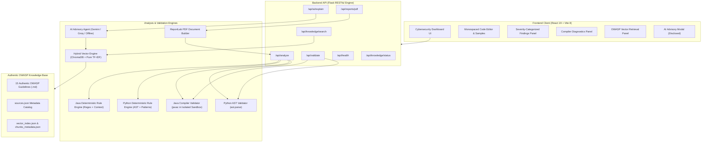

# Smart Code Inspection Platform with Vulnerability Detection System

[](https://www.python.org/)
[](https://openjdk.org/)
[](https://react.dev/)
[](https://vite.dev/)
[](https://owasp.org/www-project-top-ten/)
[](LICENSE)

An enterprise-grade static code analysis, security auditing, and OWASP compliance platform engineered for Python and Java codebases. 

The platform guarantees **strict zero-execution static inspection** (submitted source code is never executed), coupled with real compiler diagnostic verification (`javac`), 11 deterministic rule detectors, a hybrid vector knowledge retrieval engine (ChromaDB + Pure-Python TF-IDF) over authentic OWASP standards, optional multi-provider AI security consultation (Google Gemini & Groq with offline fallback), and downloadable ReportLab PDF audit reports.

---

## 🏛️ System Architecture



---

## 📂 Project Structure

```text
SmartCodeInspect/
├── .env.example                 # Root environment template (placeholders only)
├── .gitignore                   # Comprehensive security ignore rules (protects API keys)
├── LICENSE                      # MIT Open-Source License
├── README.md                    # Project documentation & execution guide
├── zip_project.py               # Clean release packaging utility
├── streamlit_app.py             # Alternative Streamlit exploratory interface
│
├── Infosys_M1_Agile_Docs/       # Agile Project Management Deliverables
│   ├── Agile_Template_v0.1.xls            # Sprint planning, backlog & user stories
│   ├── Defect_Tracker Template_v0.1.xlsx  # Defect triage & bug lifecycle tracking
│   └── Unit_Test_Plan_v0.1.xlsx           # Unit test scenarios & coverage plan
│
├── documentation/               # Technical & Architecture Specifications
│   ├── ARCHITECTURE.md          # Architectural blueprints, data flow & formulas
│   ├── SAMPLE_SCENARIOS.md      # 6 standard test scenarios with expected outcomes
│   └── SECURITY.md              # Sandboxing guarantees, ReDoS prevention & privacy
│
├── backend/                     # Python Flask API & Core Analysis Engines
│   ├── .env.example             # Backend environment template
│   ├── app.py                   # Primary Flask application entry point
│   ├── config.py                # Centralized configuration & environment loader
│   ├── fastapi_app.py           # Alternative FastAPI implementation
│   ├── pytest.ini               # Pytest configuration
│   ├── requirements.txt         # Python dependencies
│   ├── agents/                  # AI Advisory provider (Gemini / Groq / Offline)
│   ├── analyzers/               # Inspection engines & 11 security rule implementations
│   ├── knowledge_base/          # Ingestion pipelines & semantic hybrid retriever
│   ├── reports/                 # ReportLab PDF executive report generator
│   ├── routes/                  # Modular Flask blueprints (health, validate, analyze, etc.)
│   ├── tests/                   # 39 automated unit & integration tests
│   └── validators/              # AST parser & javac compiler subprocess wrappers
│
├── frontend/                    # Modern React 19 + Vite 8 Dashboard
│   ├── index.html               # Main HTML entry point
│   ├── package.json             # NPM dependencies & scripts
│   ├── vite.config.js           # Vite build and proxy configuration
│   ├── public/                  # Static brand assets and SVGs
│   └── src/
│       ├── App.jsx              # Root reactive application component
│       ├── main.jsx             # React DOM entry point
│       ├── components/          # Dashboard panels (Editor, Findings, Diagnostics, etc.)
│       ├── constants/           # Sample code files (vulnerable and secure code)
│       └── services/            # API communication services (REST & PDF downloads)
│
└── knowledge_base/              # Authentic Security Standards & Indexes
    ├── documents/               # 15 Authentic OWASP Guidelines & Cheat Sheets (.md)
    ├── index/                   # ChromaDB storage & pure-Python TF-IDF vector indexes
    └── sources.json             # Document catalog with titles, URLs, and categories
```

---

## ✨ Key Features & Capabilities

1. **Zero-Execution Static Security**:
   - Analyzes Python and Java code purely through Abstract Syntax Tree (AST) parsing, compiler diagnostics, and deterministic inspection rules.
   - **Never executes** submitted code, never uses `eval()` or `exec()`, and isolates compiler invocations in temporary, non-executable directories.
2. **Real Java Compiler Diagnostics**:
   - Invokes `javac -d <temp> -Xlint:all` with automated public class name extraction and a strict 10-second timeout ceiling (`shell=False`).
   - Surfaces real compiler syntax errors, missing imports, unhandled exceptions, and deprecation notices with exact line and column coordinates.
3. **11 Deterministic Security Rules**:
   - `SEC-PY-001`: Arbitrary Code Execution (`eval`, `exec`)
   - `SEC-PY-002`: OS Command Injection (`subprocess` with `shell=True`, `os.system`, `os.popen`)
   - `SEC-PY-003`: SQL Injection via unescaped string formatting
   - `SEC-PY-004`: Hardcoded sensitive credentials & tokens
   - `SEC-PY-005`: Insecure Deserialization (`pickle.loads`)
   - `SEC-PY-006`: Broken Cryptographic Hashing (`MD5`, `SHA1`)
   - `SEC-JV-001`: SQL Injection via unparameterized concatenation
   - `SEC-JV-002`: OS Command Injection (`Runtime.getRuntime().exec`)
   - `SEC-JV-003`: Hardcoded API Keys & Passwords
   - `SEC-JV-004`: Insecure Java Deserialization (`ObjectInputStream`)
   - `SEC-JV-005`: Weak Cryptography (`MD5`, `DES`)
4. **Hybrid OWASP Knowledge Base (ChromaDB + Pure TF-IDF)**:
   - Contains 15 authentic Markdown documents from the OWASP Top 10 and OWASP Cheat Sheet Series.
   - Employs **ChromaDB** as primary semantic vector store with a custom **Zero-DLL Pure-Python TF-IDF & Cosine Similarity** engine as fallback for hardened environments.
5. **Multi-Provider AI Advisory with Explicit Disclosure**:
   - Supports **Google Gemini** (`gemini-3.8-flash`) and **Groq** (`llama-3.1-8b-instant`) with automatic fallback to an **Offline Curated Advisory** mode.
   - Complies with strict privacy standards: user consent is requested before any finding metadata is transmitted externally.
6. **Executive PDF Audit Reports**:
   - Automatically builds downloadable, multi-page PDF inspection reports complete with executive metadata, severity distribution charts, finding evidence snippets, and OWASP references using ReportLab.
7. **Infosys Agile Deliverables (`Infosys_M1_Agile_Docs/`)**:
   - Bundled with complete Agile project management artifacts: Sprint Planning & User Stories (`Agile_Template_v0.1.xls`), Defect Tracking (`Defect_Tracker Template_v0.1.xlsx`), and Unit Test Coverage Plan (`Unit_Test_Plan_v0.1.xlsx`).

---

## 🚀 Quickstart Guide

### Prerequisites
- **Python**: 3.10+ (tested on Python 3.14)
- **Node.js**: v18+ (tested on Node v24.15)
- **Java JDK**: JDK 17+ (`javac` must be accessible in your `PATH`)

---

### 1. Backend Setup

```bash
# Navigate to the backend directory
cd backend

# Create and activate a virtual environment
python -m venv venv

# Windows PowerShell:
.\venv\Scripts\Activate.ps1
# Linux / macOS:
source venv/bin/activate

# Install dependencies (use python -m pip if pip.exe is restricted)
python -m pip install -r requirements.txt

# Run all backend unit & integration tests (39 tests)
pytest -v

# Start the Flask API server
python app.py
```
> The backend API server will start on **`http://127.0.0.1:5000`**.

---

### 2. Frontend Setup

```bash
# Open a second terminal and navigate to frontend
cd frontend

# Install Node dependencies
npm install

# Run the automated frontend tests (Vitest + RTL)
npm test

# Start the local development server
npm run dev
```
> The React dashboard will be accessible at **`http://127.0.0.1:5173`**.

---

## ⚙️ Environment Variables Configuration

Copy the template configuration file:

```bash
# In the backend directory:
cp .env.example .env
```

```ini
# Flask Server Configuration
FLASK_ENV=development
FLASK_DEBUG=0
HOST=127.0.0.1
PORT=5000

# Front-End Origin
FRONTEND_ORIGIN=http://127.0.0.1:5173

# Safety Limits
MAX_SOURCE_BYTES=200000
JAVA_COMPILE_TIMEOUT_SECONDS=10

# AI Advisory Configuration (Optional)
# Providers: 'gemini', 'groq', or 'offline'
AI_PROVIDER=gemini
GEMINI_API_KEY=your_gemini_api_key_here
GEMINI_MODEL=gemini-3.8-flash
GEMINI_MAX_RPM=10
GEMINI_COOLDOWN_SECONDS=2.0
```

> **Note**: If `GEMINI_API_KEY` is not provided, the platform automatically runs in **Offline Advisory Mode** without errors.

---

## 📡 REST API Reference

| Endpoint | Method | Description |
| :--- | :--- | :--- |
| `/api/health` | `GET` | Verifies API health, `javac` availability, vector index status, and AI provider readiness. |
| `/api/validate` | `POST` | Validates syntax for Python (AST) or Java (`javac`) without executing code. |
| `/api/analyze` | `POST` | Executes complete AST parsing and deterministic security rule inspection. |
| `/api/knowledge/status` | `GET` | Returns the indexing status and chunk counts of the OWASP knowledge base. |
| `/api/knowledge/search` | `POST` | Queries the hybrid Vector Space Model over authentic OWASP standards. |
| `/api/ai/explain` | `POST` | Returns safe, structured educational advice for a specific vulnerability finding. |
| `/api/reports/pdf` | `POST` | Generates a binary PDF vulnerability report from inspection data. |

---

## 🧪 Automated Testing

### Backend Test Suite
```bash
cd backend
pytest -v
```
* **39 passing tests** covering AST parsing, compiler sandbox execution, rule matching, vector indexing, retrieval rankings, ReportLab PDF rendering, and API response serialization.

### Frontend Test Suite
```bash
cd frontend
npm test
```
* **7 passing Vitest + React Testing Library suites** verifying UI rendering, language toggle, sample selection, syntax validation banners, finding cards, knowledge base querying, and offline error boundaries.

---

## 📄 Technical Documentation

For deeper architectural and security details, review the documentation files:
* **[System Architecture](documentation/ARCHITECTURE.md)**: Architectural blueprints, component interactions, and vector mathematical formulations.
* **[Security Policy & Sandboxing](documentation/SECURITY.md)**: Execution safety guarantees, ReDoS prevention, and privacy models.
* **[Sample Scenarios & Test Payloads](documentation/SAMPLE_SCENARIOS.md)**: 6 standard inspection scenarios with expected outcomes.

---

## 🛡️ License

Distributed under the **MIT License**. See [`LICENSE`](LICENSE) for more information.
