# Smart Code Inspection Platform with Vulnerability Detection System

[](https://www.python.org/)
[](https://openjdk.org/)
[](https://react.dev/)
[](https://vite.dev/)
[](https://owasp.org/www-project-top-ten/)
[](#-multi-agent-orchestration-architecture)
[](#-automated-testing)
[](LICENSE)

An enterprise-grade static code analysis, security auditing, multi-agent orchestration, and OWASP compliance platform engineered for Python and Java codebases. 

The platform guarantees **strict zero-execution static inspection** (submitted source code is never executed), coupled with real compiler diagnostic verification (`javac`), parallel **multi-agent orchestration** (Code Analysis Agent + Security Vulnerability Agent), 11+ deterministic security rule detectors, a hybrid vector knowledge retrieval engine (ChromaDB + Pure-Python TF-IDF) over authentic **OWASP 2026 Standards**, optional multi-provider AI security consultation (Google Gemini & Groq with offline fallback), and downloadable ReportLab PDF audit reports.

---

## 🏛️ System Architecture

```mermaid
flowchart TD
    subgraph Client["Frontend Client (React 19 + Vite 8)"]
        UI["Cybersecurity Dashboard UI"]
        Editor["Monospaced Code Editor & Samples"]
        FindingsView["Severity-Categorized Findings Panel"]
        DiagnosticsView["Compiler Diagnostics Panel"]
        KBView["OWASP Vector Retrieval Panel"]
        AIModal["AI Advisory Modal (Disclosed)"]
    end

    subgraph API["Backend API (Flask RESTful Engine)"]
        HealthRoute["/api/health"]
        ValidateRoute["/api/validate"]
        AnalyzeRoute["/api/analyze"]
        OrchestrateRoute["/api/orchestrate"]
        KBStatusRoute["/api/knowledge/status"]
        KBSearchRoute["/api/knowledge/search"]
        AIRoute["/api/ai/explain"]
        ReportRoute["/api/reports/pdf"]
    end

    subgraph Orchestrator["Multi-Agent Orchestrator (Concurrent Thread Pool)"]
        direction TB
        CodeAgent["Code Analysis Agent<br/>(Smells, Complexity, Anti-Patterns)"]
        SecAgent["Security Vulnerability Agent<br/>(OWASP 2026, CWE Mappings)"]
        Merger["Unified Findings Merger & Deduplicator<br/>(Security Posture Grade & Quality Score)"]
    end

    subgraph Core["Analysis & Validation Engines"]
        PyVal["Python AST Validator (ast.parse)"]
        JavVal["Java Compiler Sandbox (javac -Xlint:all)"]
        PyRules["Python Deterministic Rule Engine"]
        JavRules["Java Deterministic Rule Engine"]
        VectorDB["Hybrid Vector Engine (ChromaDB + TF-IDF)"]
        AIProvider["AI Advisory Agent (Gemini / Groq / Offline)"]
        PDFGen["ReportLab PDF Document Builder"]
    end

    subgraph Knowledge["Authentic OWASP 2026 Knowledge Base"]
        OWASPDocs["15 Authentic OWASP Documents (.md)<br/>(10 Documents >= 300 Lines Each)"]
        Catalog["sources.json Metadata Catalog"]
        Precomputed["vector_index.json & chunks_metadata.json<br/>(521+ Chunks, 4258 Vocabulary Terms)"]
    end

    UI --> API
    ValidateRoute --> PyVal & JavVal
    AnalyzeRoute --> PyRules & JavRules
    OrchestrateRoute --> Orchestrator
    Orchestrator --> CodeAgent & SecAgent
    CodeAgent & SecAgent --> Merger
    KBSearchRoute --> VectorDB
    VectorDB --> Knowledge
    AIRoute --> AIProvider
    AIProvider --> VectorDB
    ReportRoute --> PDFGen
    PDFGen --> AnalyzeRoute
```



---

## 📂 Project Structure

```text
SmartCodeInspect/
├── .env.example                 # Root environment template (placeholders only)
├── .gitignore                   # Comprehensive security ignore rules (protects API keys)
├── LICENSE                      # MIT Open-Source License (2026)
├── README.md                    # Project documentation & execution guide
├── zip_project.py               # Clean release packaging utility
├── streamlit_app.py             # Alternative Streamlit exploratory interface
│
├── Infosys_Agile_Docs/          # Agile Project Management Deliverables
│   ├── Agile_Template_v0.1.xlsx           # Sprint planning, backlog & user stories
│   ├── Defect_Tracker Template_v0.1.xlsx  # Defect triage & bug lifecycle tracking
│   └── Unit_Test_Plan_v0.1.xlsx           # Unit test scenarios & coverage plan
│
├── documentation/               # Technical & Architecture Specifications
│   ├── ARCHITECTURE.md          # Architectural blueprints, data flow & formulas
│   ├── SAMPLE_SCENARIOS.md      # 6 standard test scenarios with expected outcomes
│   └── SECURITY.md              # Sandboxing guarantees, ReDoS prevention & privacy
│
├── backend/                     # Python Flask API & Core Analysis Engines
│   ├── .env.example             # Backend environment template
│   ├── app.py                   # Primary Flask application entry point
│   ├── config.py                # Centralized configuration & environment loader
│   ├── fastapi_app.py           # Alternative FastAPI implementation
│   ├── pytest.ini               # Pytest configuration
│   ├── requirements.txt         # Python dependencies
│   ├── agents/                  # Multi-Agent Orchestration & AI Consultation
│   │   ├── orchestrator.py          # Parallel multi-agent runner, deduplication, scoring
│   │   ├── code_analysis_agent.py   # Code smells, complexity, AST & structural analysis
│   │   ├── security_agent.py        # OWASP standards, CWE mapping, SSRF, path traversal
│   │   └── ai_agent.py              # LLM Advisory provider (Gemini / Groq / Offline)
│   ├── analyzers/               # Deterministic security rule implementations
│   ├── knowledge_base/          # Ingestion pipelines & semantic hybrid retriever
│   │   ├── ingest.py                # Document chunking, TF-IDF and ChromaDB ingestion
│   │   └── retriever.py             # Hybrid vector retriever with query normalization
│   ├── reports/                 # ReportLab PDF executive report generator
│   ├── routes/                  # Modular Flask blueprints (health, validate, analyze, orchestrate)
│   ├── tests/                   # 63 automated unit, agent & integration tests
│   └── validators/              # AST parser & javac compiler subprocess wrappers
│
├── frontend/                    # Modern React 19 + Vite 8 Dashboard
│   ├── index.html               # Main HTML entry point
│   ├── package.json             # NPM dependencies & scripts
│   ├── vite.config.js           # Vite build and proxy configuration
│   ├── public/                  # Static brand assets and SVGs
│   └── src/
│       ├── App.jsx              # Root reactive application component
│       ├── main.jsx             # React DOM entry point
│       ├── components/          # Dashboard panels (Editor, Findings, Diagnostics, etc.)
│       ├── constants/           # Sample code files (vulnerable and secure code)
│       └── services/            # API communication services (REST & PDF downloads)
│
└── knowledge_base/              # Authentic Security Standards & Indexes
    ├── documents/               # 15 Authentic OWASP Guidelines & Cheat Sheets (.md)
    │   ├── owasp_top_10_2026.md                # OWASP Top 10: 2026 Standard (443 lines)
    │   ├── owasp_ssrf_prevention.md            # SSRF Defense & DNS Rebinding (462 lines)
    │   ├── owasp_path_traversal_prevention.md  # Path Traversal & Zip Slip (432 lines)
    │   ├── owasp_api_security.md               # API Security Top 10 (384 lines)
    │   ├── owasp_cryptographic_storage.md      # AEAD AES-256-GCM & Key Mgmt (372 lines)
    │   ├── owasp_sql_injection_prevention.md   # SQLi & Parameterization (352 lines)
    │   ├── owasp_deserialization_cheat_sheet.md# Deserialization & Gadget Chains (347 lines)
    │   ├── owasp_secrets_management_cheat_sheet.md # Secrets Vaults & Redaction (345 lines)
    │   ├── owasp_authentication_cheat_sheet.md # Argon2id, bcrypt, WebAuthn (342 lines)
    │   ├── owasp_os_command_injection_defense.md # Command Injection Defense (327 lines)
    │   ├── owasp_broken_access_control.md      # Access Control & IDOR Defense
    │   ├── owasp_input_validation_cheat_sheet.md # Allowlist Validation
    │   ├── owasp_secure_file_uploads.md        # File Upload Validation
    │   ├── owasp_security_misconfiguration.md  # Configuration Hardening
    │   └── owasp_xss_prevention.md             # Contextual Output Encoding
    ├── index/                   # ChromaDB storage & pure-Python TF-IDF vector indexes
    └── sources.json             # Document catalog with titles, URLs, and categories
```

---

## ✨ Key Features & Capabilities

### 1. Multi-Agent Orchestration Architecture
- **Parallel Agent Execution**: Operates a concurrent `ThreadPoolExecutor` running the **Code Analysis Agent** and the **Security Vulnerability Agent** simultaneously.
- **Code Analysis Agent**: Detects code smells (God functions, long parameter lists, high cognitive complexity), cyclomatic complexity branching, resource management leaks (unclosed files/streams), dead code, and poor coding conventions with calibrated severity scoring (`COMPLEX-PY-001`, `SMELL-PY-001`, `PRACTICE-PY-001` through `006`, and Java equivalents).
- **Security Vulnerability Agent**: Scans for OWASP Top 10 vulnerabilities, maps exact Common Weakness Enumerations (CWE-22, CWE-78, CWE-89, CWE-502, CWE-798, CWE-918), validates URL schemes/destinations for SSRF, detects path traversal with canonical containment checks, and tags exact line and column locations with evidence snippets.
- **Unified Finding Aggregator**: Deduplicates overlapping findings using composite category keys, calculates bounded Quality Scores (0–100), and assigns independent Security Posture Grades (A through F).

### 2. Zero-Execution Static Security
- Analyzes Python and Java code purely through Abstract Syntax Tree (AST) parsing, compiler diagnostics, and deterministic inspection rules.
- **Never executes** submitted code, never uses `eval()` or `exec()`, and isolates compiler invocations in temporary, non-executable directories.

### 3. Real Java Compiler Diagnostics
- Invokes `javac -d <temp> -Xlint:all` with automated public class name extraction and a strict 10-second timeout ceiling (`shell=False`).
- Surfaces real compiler syntax errors, missing imports, unhandled exceptions, and deprecation notices with exact line and column coordinates.

### 4. Hybrid OWASP Knowledge Base (OWASP 2026 Standard)
- Contains **10 comprehensive cheat sheets with at least 300 lines each** (spanning 327 to 462 lines), updated to the **2026 Edition (retrieved 2026-10-25)**.
- Covers complete threat models, CWE classifications, vulnerable vs. secure code patterns in both Python 3.11+ and Java 17/21+, SAST detection rules, and security verification checklists.
- Indexed across **521+ semantic chunks** into **ChromaDB** with a pure-Python TF-IDF vector space fallback engine (4,258 vocabulary terms).

### 5. Multi-Provider AI Advisory with Explicit Disclosure
- Supports **Google Gemini** (`gemini-3.8-flash`) and **Groq** (`llama-3.1-8b-instant`) with automatic fallback to an **Offline Curated Advisory** mode.
- Complies with strict privacy standards: user consent is requested before any finding metadata is transmitted externally.

### 6. Executive PDF Audit Reports
- Automatically builds downloadable, multi-page PDF inspection reports complete with executive metadata, severity distribution charts, finding evidence snippets, and OWASP references using ReportLab.

### 7. Infosys Agile Deliverables (`Infosys_Agile_Docs/`)
- Bundled with complete Agile project management artifacts: Sprint Planning & User Stories (`Agile_Template_v0.1.xlsx`), Defect Tracking (`Defect_Tracker Template_v0.1.xlsx`), and Unit Test Coverage Plan (`Unit_Test_Plan_v0.1.xlsx`).

---

## 🚀 Quickstart Guide

### Prerequisites
- **Python**: 3.10+ (tested on Python 3.14)
- **Node.js**: v18+ (tested on Node v24.15)
- **Java JDK**: JDK 17+ (`javac` must be accessible in your `PATH`)

---

### 1. Backend Setup

```bash
# Navigate to the backend directory
cd backend

# Create and activate a virtual environment
python -m venv venv

# Windows PowerShell:
.\venv\Scripts\Activate.ps1
# Linux / macOS:
source venv/bin/activate

# Install dependencies (use python -m pip if pip.exe is restricted)
python -m pip install -r requirements.txt

# Ingest and index the OWASP Knowledge Base into ChromaDB & TF-IDF
python -c "from knowledge_base.ingest import run_ingestion; run_ingestion()"

# Run all backend unit, agent & integration tests (63 tests)
pytest -v

# Start the Flask API server
python app.py
```
> The backend API server will start on **`http://127.0.0.1:5000`**.

---

### 2. Frontend Setup

```bash
# Open a second terminal and navigate to frontend
cd frontend

# Install Node dependencies
npm install

# Run the automated frontend tests (Vitest + RTL)
npm test -- --run

# Start the local development server
npm run dev
```
> The React dashboard will be accessible at **`http://127.0.0.1:5173`**.

---

## ⚙️ Environment Variables Configuration

Copy the template configuration file:

```bash
# In the backend directory:
cp .env.example .env
```

```ini
# Flask Server Configuration
FLASK_ENV=development
FLASK_DEBUG=0
HOST=127.0.0.1
PORT=5000

# Front-End Origin
FRONTEND_ORIGIN=http://127.0.0.1:5173

# Safety Limits
MAX_SOURCE_BYTES=200000
JAVA_COMPILE_TIMEOUT_SECONDS=10

# AI Advisory Configuration (Optional)
# Providers: 'gemini', 'groq', or 'offline'
AI_PROVIDER=gemini
GEMINI_API_KEY=your_gemini_api_key_here
GEMINI_MODEL=gemini-3.8-flash
GEMINI_MAX_RPM=10
GEMINI_COOLDOWN_SECONDS=2.0
```

> **Note**: If `GEMINI_API_KEY` is not provided, the platform automatically runs in **Offline Advisory Mode** without errors.

---

## 📡 REST API Reference

| Endpoint | Method | Description |
| :--- | :--- | :--- |
| `/api/health` | `GET` | Verifies API health, `javac` availability, vector index status, and AI provider readiness. |
| `/api/validate` | `POST` | Validates syntax for Python (AST) or Java (`javac`) without executing code. |
| `/api/analyze` | `POST` | Executes complete AST parsing and deterministic security rule inspection. |
| `/api/orchestrate` | `POST` | Executes parallel multi-agent analysis (Code Analysis + Security Vulnerability agents) with unified findings and security grade. |
| `/api/knowledge/status` | `GET` | Returns the indexing status and chunk counts of the OWASP knowledge base. |
| `/api/knowledge/search` | `POST` | Queries the hybrid Vector Space Model (ChromaDB + TF-IDF) over authentic OWASP standards. |
| `/api/ai/explain` | `POST` | Returns safe, structured educational advice for a specific vulnerability finding. |
| `/api/reports/pdf` | `POST` | Generates a binary PDF vulnerability report from inspection data. |

---

## 🧪 Automated Testing

### Backend Test Suite
```bash
cd backend
pytest -v
```
* **63 passing tests** covering:
  - Python AST parsing and syntax diagnostics
  - Java compiler sandboxing and javac subprocess execution
  - Deterministic security rule detection (Python & Java)
  - Code Analysis Agent (code smells, complexity, anti-patterns, conventions)
  - Security Vulnerability Agent (OWASP compliance, CWE mappings, SSRF, path traversal)
  - Multi-Agent Orchestrator (parallel thread pools, timeout handling, error sanitization, deduplication, scoring)
  - OWASP RAG Pipeline (chunking, TF-IDF vector indexing, ChromaDB retrieval)
  - ReportLab PDF generation
  - REST API endpoint contracts and JSON schema validation

### Frontend Test Suite
```bash
cd frontend
npm test -- --run
```
* **7 passing Vitest + React Testing Library suites** verifying UI rendering, language toggle, sample selection, syntax validation banners, finding cards, knowledge base querying, and offline error boundaries.

---

## 📄 Technical Documentation

For deeper architectural and security details, review the documentation files:
* **[System Architecture](documentation/ARCHITECTURE.md)**: Architectural blueprints, component interactions, and vector mathematical formulations.
* **[Security Policy & Sandboxing](documentation/SECURITY.md)**: Execution safety guarantees, ReDoS prevention, and privacy models.
* **[Sample Scenarios & Test Payloads](documentation/SAMPLE_SCENARIOS.md)**: 6 standard inspection scenarios with expected outcomes.

---

## 🛡️ License

Distributed under the **MIT License**. See [`LICENSE`](LICENSE) for more information.
Copyright (c) 2026 SmartCodeInspect Contributors.
