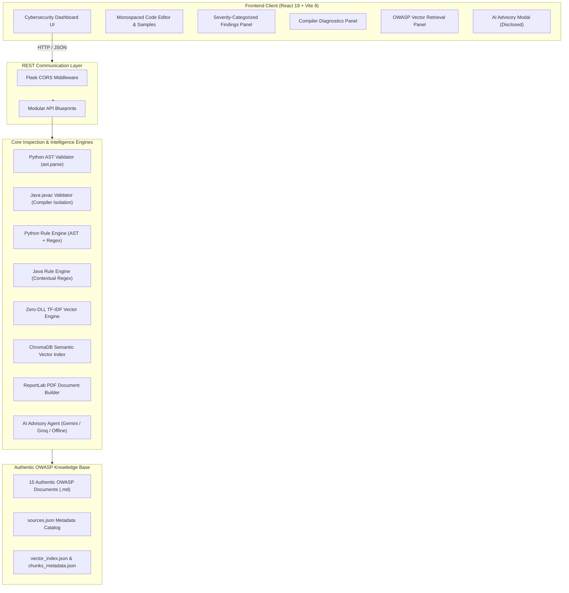

# System Architecture & Technical Specifications

This document outlines the architectural blueprints, component interactions, safety models, and mathematical formulations powering the **Smart Code Inspection Platform with Vulnerability Detection System**.

---

## 1. High-Level Architecture Overview

The platform uses a decoupled client-server architecture consisting of a **React 19 single-page dashboard** communicating over standard RESTful endpoints with a **Flask API**. The system enforces static analysis without executing user-supplied source code.



---

## 2. Validation & Static Inspection Pipeline

### 2.1 Python AST Parser (`validators/python_validator.py`)
Python validation leverages Python's native `ast.parse` standard library module:
- **Zero Dynamic Execution**: `ast.parse` constructs an in-memory Abstract Syntax Tree representation of the code without executing module-level statements, functions, side effects, or imports.
- **Payload Size Ceiling**: Enforces a strict default byte limit (`200,000` bytes, configurable via `MAX_SOURCE_BYTES`) to prevent memory exhaustion.
- **Diagnostic Mapping**: Syntax errors throw standard `SyntaxError` exceptions containing accurate `lineno`, `offset`, and the exact code line excerpt, which are normalized into the platform's diagnostic schema:
  ```json
  {
    "line": 4,
    "column": 48,
    "severity": "error",
    "message": "SyntaxError: '(' was never closed",
    "evidence": "final_price = price * (1 - (discount_percent / 100)"
  }
  ```

### 2.2 Java Compiler Isolation (`validators/java_validator.py`)
Java code is validated using the local OpenJDK compiler (`javac`):
- **Temporary Isolation**: The source code is written to an isolated directory created via `tempfile.mkdtemp(prefix="sci_java_")`.
- **Primary Class Extraction**: The validator parses public class, record, interface, or enum names using regex while stripping comments (`//` and `/* ... */`), naming the `.java` file accurately to satisfy Java compiler specification requirements.
- **Execution Flags**: The compiler is invoked with:
  ```bash
  javac -d <temp_dir> -Xlint:all <SourceFile>.java
  ```
- **Bytecode Non-Execution**: The compiler outputs compiled `.class` bytecode to the temporary directory solely to verify type safety and language compliance; **bytecode is never executed** (`java` runtime is never invoked on user code).
- **Subprocess Security**: Invoked via `subprocess.run` with argument lists (never `shell=True`) and a strict 10-second timeout ceiling (`subprocess.TimeoutExpired`).
- **Diagnostic Regex Parser**: Captures compiler output matching:
  ```regex
  ^([a-zA-Z0-9_\-\.]+):(\d+):(?:\s*(\w+):)?\s*(.*)$
  ```
  Extracts precise line numbers, columns, and severity levels (`error` vs `warning`).

---

## 3. Deterministic Security Rulebook

The platform implements 11 deterministic security inspection rules across Python and Java:

| Rule ID | Language | Description | Detection Strategy | OWASP Top 10 Standard |
| :--- | :--- | :--- | :--- | :--- |
| `SEC-PY-001` | Python | Unsafe `eval()` / `exec()` | AST `Call` node inspecting `func.id` | A03:2021-Injection |
| `SEC-PY-002` | Python | OS Command Injection | AST `Call` node with `shell=True` keyword argument | A03:2021-Injection |
| `SEC-PY-003` | Python | SQL Injection | AST `Call` matching `execute` + String Formatting (`FormattedValue`, `%`, `.format`) | A03:2021-Injection |
| `SEC-PY-004` | Python | Hardcoded Secrets | High-entropy regex patterns matching secret variable names & API keys | A07:2021-Identification |
| `SEC-PY-005` | Python | Insecure Deserialization | AST `Call` matching `pickle.loads` / `pickle.load` | A08:2021-Integrity |
| `SEC-PY-006` | Python | Broken Cryptographic Hash | AST `Call` matching `hashlib.md5()` / `hashlib.sha1()` | A02:2021-Cryptographic |
| `SEC-JV-001` | Java | SQL Injection Concatenation | Regex matching `executeQuery` / `executeUpdate` with `+` concatenations | A03:2021-Injection |
| `SEC-JV-002` | Java | OS Command Injection | Regex matching `Runtime.getRuntime().exec` / `ProcessBuilder` | A03:2021-Injection |
| `SEC-JV-003` | Java | Hardcoded Secrets | High-entropy regex matching `AWS_SECRET`, `API_KEY`, `PASSWORD` assignments | A07:2021-Identification |
| `SEC-JV-004` | Java | Insecure Deserialization | Regex matching `ObjectInputStream.readObject()` | A08:2021-Integrity |
| `SEC-JV-005` | Java | Weak Cryptographic Hash | Regex matching `MessageDigest.getInstance("MD5")` or `"SHA-1"` | A02:2021-Cryptographic |

---

## 4. Hybrid Knowledge Retrieval Engine (ChromaDB + Pure Python TF-IDF)

The knowledge retrieval layer provides authentic OWASP remediation guidance using a hybrid architecture:

### 4.1 Document Ingestion & Chunking
- Ingests authentic OWASP Markdown documents from `knowledge_base/documents/` (15 guidelines including OWASP Top 10, SQL Injection, Command Injection, Secrets Management, SSRF, Deserialization, etc.).
- Splits documents into coherent semantic chunks preserving metadata (Title, Section, Category, Official URL) recorded in `knowledge_base/sources.json`.

### 4.2 Primary Engine: ChromaDB Persistent Store
- Persistent vector collection stored in `knowledge_base/index/chroma/`.
- Fast semantic vector search returning top matching passages.

### 4.3 Fallback Engine: Zero-DLL Pure Python Vector Space Model
To ensure zero external native DLL dependencies in hardened or air-gapped environments:
- Pre-computed TF-IDF index stored in `knowledge_base/index/vector_index.json` and `knowledge_base/index/chunks_metadata.json`.
- **Term Frequency-Inverse Document Frequency (TF-IDF)**:
  $$\text{TF}(t, d) = \frac{f_{t, d}}{\sum_{t' \in d} f_{t', d}}$$
  $$\text{IDF}(t) = \ln\left(1 + \frac{N}{1 + n_t}\right) + 1$$
  $$\text{TF-IDF}(t, d) = \text{TF}(t, d) \times \text{IDF}(t)$$
- **Cosine Similarity Matching**:
  $$\text{Cosine Similarity}(q, d) = \frac{\mathbf{v}_q \cdot \mathbf{v}_d}{\|\mathbf{v}_q\| \|\mathbf{v}_d\|} = \frac{\sum_{t \in q \cap d} w_{t, q} \cdot w_{t, d}}{\sqrt{\sum_{t \in q} w_{t, q}^2} \sqrt{\sum_{t \in d} w_{t, d}^2}}$$

---

## 5. Multi-Provider AI Advisory Subsystem (`agents/ai_provider.py`)

The platform integrates an AI consultation agent with strict security boundaries:
1. **Multi-Provider Support**: Supports **Google Gemini** (`gemini-3.8-flash`) and **Groq** (`llama-3.1-8b-instant`).
2. **Offline Curated Advisory Fallback**: If no API key is configured or rate limits are reached, the system automatically falls back to an offline deterministic advisory generated from the local rulebook.
3. **Rate Limiting & Throttling**: Sliding window rate limiter (10 requests/min maximum) with a 2.0-second inter-request cooldown to respect free-tier quotas.
4. **In-Memory LRU Cache**: SHA-256 caching of finding signatures (`rule_id + title + evidence`) with a 1-hour TTL to prevent duplicate API queries.
5. **Prompt Shielding & Consent Disclosure**: Source code is treated as untrusted data; raw credentials are never transmitted; and the frontend requires explicit user consent before advisory generation.

---

## 6. ReportLab Executive PDF Generator (`reports/pdf_generator.py`)

The report generation pipeline builds downloadable security audit reports:
- **Title Block & Metadata**: Executive summary with target filename, inspection timestamp (UTC), language, compiler status, and tool version.
- **Executive Vulnerability Summary Table**: Color-coded risk breakdown of Total Findings, Critical, High, Medium, and Low/Info vulnerabilities.
- **Detailed Findings Registry**:
  - Rule ID, severity badge, line number.
  - Formatted monospaced code evidence box with secret token masking.
  - Risk implications and step-by-step remediation guidance.
  - Clickable OWASP reference hyperlinks.
  - Wrapped with `KeepTogether` to eliminate awkward page breaks.
- **AI Advisory Section**: Optional AI-generated advisory remediation with explicit advisory disclaimers.
- **Audit Scope & Limitations Stamp**: Legal and compliance disclaimer detailing static analysis boundaries.

---

## 7. REST API Endpoints Specification

| Method | Endpoint | Description | Request Payload | Response Schema |
| :--- | :--- | :--- | :--- | :--- |
| `GET` | `/api/health` | System health & AI engine status | None | `{"status": "healthy", "ai_status": {...}}` |
| `POST` | `/api/validate` | Syntax & compiler verification | `{"language", "source_code", "filename"}` | `{"valid_syntax", "diagnostics", "message", "total_lines"}` |
| `POST` | `/api/analyze` | Full security rulebook inspection | `{"language", "source_code", "filename"}` | `{"valid_syntax", "summary", "findings", "diagnostics"}` |
| `GET` | `/api/knowledge/status` | Vector knowledge base status | None | `{"status", "chunks_count", "sources_count"}` |
| `POST` | `/api/knowledge/search` | OWASP semantic vector search | `{"query", "top_k"}` | `{"query", "results": [...]}` |
| `POST` | `/api/ai/explain` | AI finding explanation | `{"finding", "owasp_passages"}` | `{"success", "explanation", "provider", "model"}` |
| `POST` | `/api/reports/pdf` | Downloadable PDF audit report | `{"analysis_data", "source_code", "language"}` | Binary PDF attachment (`application/pdf`) |
